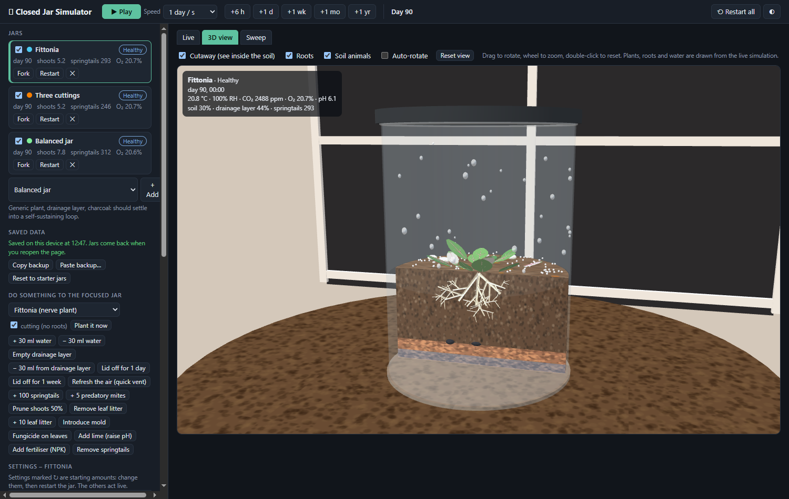
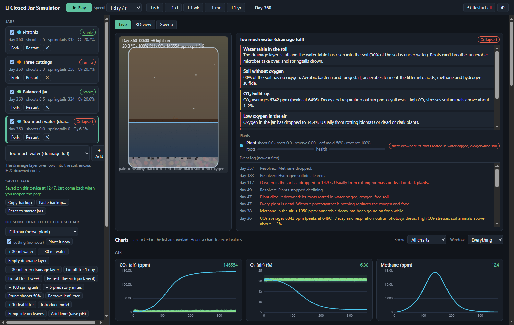
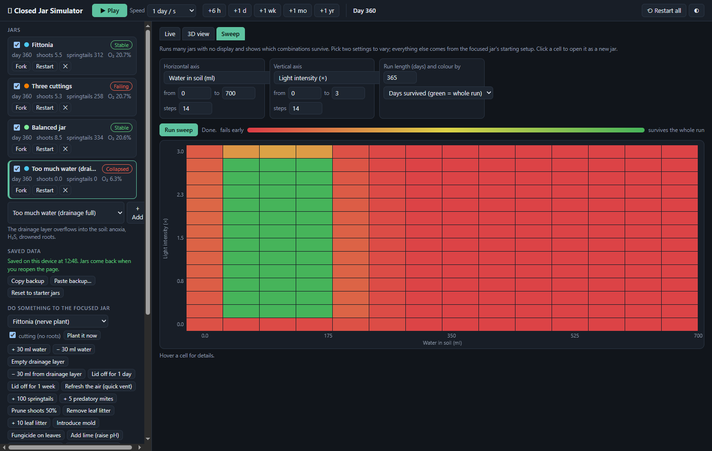

<div align="center">

# 🫙 Closed Jar Simulator

**A mechanistic ecosystem simulator for sealed terrariums: plants, soil life, water, gases and disease, in the browser, with a live 3D cutaway.**

[**▶ Live demo**](https://svencel.github.io/closed-jar-simulator/) · [How real are the numbers?](PARAMETERS.md) · [Run it](#run-it)

[](https://github.com/SVencel/closed-jar-simulator/actions/workflows/test.yml)




</div>

Seal a plant, some soil and a handful of springtails in a jar and it can run for years on its own, or it can mould, flood,
suffocate or cook. This project simulates **why**. Set up several jars, add "a bit more water" or "more springtails", then watch
whether the jar corrects itself or collapses, with charts for every variable, an event log that explains what went wrong, and parameter sweeps
that map out the whole survival region.

No build step, no framework, no dependencies: open `index.html`.

## What you can do with it

| | |
|---|---|
| **Run several jars side by side** | Fork a jar, change one thing (more water, a hotter lamp, no springtails) and compare every chart overlaid. |
| **Poke it** | Add water, drain the drainage layer, add mold, prune, leave the lid off for a day, plant a cutting. Each is a button. |
| **Understand failures** | Daily health rules turn raw state into plain-language warnings and a timeline ("water table in the soil", "soil without oxygen", "plant died: its roots rotted in waterlogged, oxygen-free soil"). |
| **Map the survival region** | The *Sweep* tab runs hundreds of headless jars across two settings and paints a heatmap of days survived. Click a cell to open that jar. |
| **Watch it in 3D** | A Three.js cutaway of the drainage layer, soil, roots (pale is healthy, dark is rotted), water table, anoxic zones, mold, springtails and mites, with a window whose sunlight follows the simulated date. |
| **Use it on a phone** | Responsive layout, pinch-zoom 3D, jars saved automatically in the browser and movable between devices as a text backup. |

<table>
<tr>
<td width="50%"></td>
<td width="50%"></td>
</tr>
<tr>
<td align="center"><sub><b>A flooded jar, day 360.</b> The log explains the chain of events: oxygen gone, plant drowned, CO₂ and methane rising.</sub></td>
<td align="center"><sub><b>Sweep: water × light.</b> A narrow band survives; too wet or too bright fails, too dark starves.</sub></td>
</tr>
</table>

## Run it

```bash
git clone https://github.com/SVencel/closed-jar-simulator.git
cd closed-jar-simulator
```

Then either double-click `index.html`, or serve it (also reachable from a phone on the same Wi-Fi):

```bash
node serve.js
```

Open http://localhost:5173. Three.js is bundled in `libs/`, so it works offline.

Headless checks (Node 18+, nothing to install):

```bash
node test/run.js                 # conservation laws + scenario checks
node test/scen.js 365            # every preset for a year
node test/probe.js water=330 drainWater=90 days=360   # one custom setup
node test/window.js 3            # windowsill jars through three seasons
```

## What is modelled

Layers: air | litter + soil | drainage layer (LECA / gravel) with optional charcoal. Hourly steps, with a quarter-hour inner loop for the fast physics.

- **Climate:** air, glass and soil temperatures with lag and lamp or sun heating; optional **seasons** (room temperature cycle and window light that follows the sun for your latitude and date); water vapour, humidity, VPD; condensation on the glass and dew on leaves; lid venting.
- **Water:** soil, drainage layer, a water table that rises into the roots when the drainage layer overflows, capillary fringe, soil texture.
- **Gases:** CO₂ (unbuffered, so it swings day and night), O₂, methane, hydrogen sulfide; soil oxygen and anoxic zones.
- **Chemistry:** pH (acids, CO₂, buffering), nitrogen, phosphorus (pH-dependent), potassium, sulfur, denitrification, charcoal binding.
- **Soil life:** litter and humus; bacteria, fungi, anaerobes; nematodes, springtails, predatory mites.
- **Plants:** per-plant shoot, roots, sugar reserve and root health; shading competition; unrooted cuttings; Liebig limiting nutrient; pH, temperature and VPD responses. Species: generic, fittonia, pothos, moss.
- **Diseases:** grey mold on leaves; Pythium-type root and stem-base rot.

Carbon, sulfur and water are conserved exactly in a sealed jar (tested); nitrogen, phosphorus and potassium are totals that can never be over-spent.

### Honest about its limits
The structure is real: real processes, real units, conserved matter. **Most rates are tuned so a balanced jar behaves sensibly, and none are calibrated against measurements of a real jar.** [PARAMETERS.md](PARAMETERS.md) tags every constant as physics `[P]`, literature-range `[L]`, tuned `[T]` or guess `[G]`. It is an ecological sketch with game-like knobs, not a predictive tool.

## Design

```
src/model.js        the simulation: pools, rates, parameter definitions, interventions   (pure JS, no DOM)
src/species.js      plant species traits: add a species = add an entry
src/diagnostics.js  daily health rules → warnings, event log, overall status
src/presets.js      starting setups (26 of them)
src/sweep.js        headless parameter sweeps
src/store.js        saving / restoring / text backups (no UI; tested in Node)
src/jar3d.js        Three.js view; reads the jar state, never changes it
src/jarview.js      2D cutaway
src/charts.js       dependency-free canvas charts + sweep heatmap
src/app.js          UI wiring
test/               conservation checks, scenarios, season runs
tools/              builds the single-file claude.ai Artifact version
```

Key decisions:
- **The core has no UI code.** The same jar object drives the charts, the 2D cutaway, the 3D scene, the sweeps and the Node tests. One simulated year runs in about 50 ms.
- **Conservation is tested, not assumed.** Every flux out of one pool must go into another or into CO₂; `test/run.js` fails if carbon, sulfur or water leak.
- **Saves survive model changes.** Jars are stored as parameters plus an action log and tagged with `model.VERSION`; after an equation change, old saves are rebuilt from their starting setup instead of crashing.
- **Knobs are data.** One entry in `PARAM_DEFS` creates the slider *and* the sweep axis.

### Extending it
- **New species:** one entry in `src/species.js`.
- **New organism:** add a pool in `resetState`, its fluxes in `step` (keep the carbon bookkeeping balanced), a chart entry in `VARS`, and rules in `diagnostics.js`.
- **New knob:** one entry in `PARAM_DEFS`.
- **3D:** `jar3d.js` reads `jar.s` / `jar.d` each frame; a new species needs a drawing style in `buildBio`.

## Saving and phones
Jars (full state, event log and chart history) autosave in the browser every few seconds and come back paused when you reopen the page.
**Copy backup / Paste backup…** moves them between devices as text. Saved data is per browser and per site address.
`node tools/build-artifact.js` builds `dist/artifact.html`, a single-page variant for hosts that supply their own document skeleton.

## Roadmap
- Calibrate against a real jar log (thermometer peak in July, lux in winter and summer).
- More animals and plants, and a bigger 3D environment.

## Credits
Three.js r128 (MIT) is vendored in `libs/`; see `libs/README.txt`. Everything else is written from scratch.

## License
[MIT](LICENSE)
